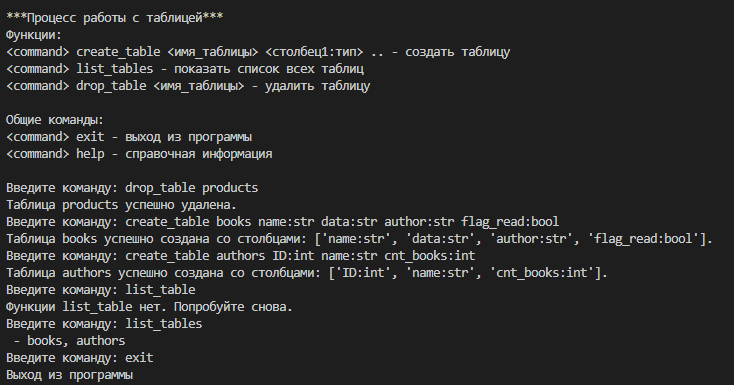

Управление таблицами.

Команда create_table <имя_таблицы> <столбец1:тип> <столбец2:тип> создает таблицу
Команда list_tables показывает список всех таблиц
Команда drop_table удаляет таблицу
Команда exit позволяет выйти из программы
Команда help выводит справочная информация 
Пример работы программы:
